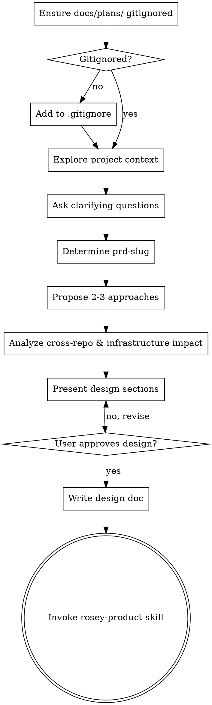

## Communication while using this skill

**Caveman lite** for all assistant prose while this skill runs: strip filler and hedging; keep articles and full sentences; stay professional and tight. Technical accuracy unchanged; quoted errors and code unchanged. Drop lite only for security warnings, irreversible confirmations, or when the user asks for normal or long-form wording.

# Brainstorming Ideas Into Designs

## Overview

Help turn ideas into fully formed designs and specs through natural collaborative dialogue.

Start by understanding the current project context, then ask questions one at a time to refine the idea. Once you understand what you're building, present the design and get user approval.

<HARD-GATE>
Do NOT invoke any implementation skill, write any code, scaffold any project, or take any implementation action until you have presented a design and the user has approved it. This applies to EVERY project regardless of perceived simplicity.
</HARD-GATE>

## Anti-Pattern: "This Is Too Simple To Need A Design"

Every project goes through this process. A todo list, a single-function utility, a config change — all of them. "Simple" projects are where unexamined assumptions cause the most wasted work. The design can be short (a few sentences for truly simple projects), but you MUST present it and get approval.

## Preconditions

### 2. Jira Ticket as Input (Optional)

If the user provides a Jira ticket key (e.g., `PROJ-123`) or URL as the starting point:

1. **Extract the issue key** from input (e.g., `https://jira.example.com/browse/PROJ-123` → `PROJ-123`)
2. **Fetch the ticket** using the Atlassian MCP:
   ```
   Tool: CallMcpTool
   Server: plugin-atlassian-atlassian
   Tool: getJiraIssue
   Args:
     - cloudId: (from user's Atlassian site URL)
     - issueIdOrKey: PROJ-123
     - responseContentFormat: markdown
   ```
3. **Use ticket content as the idea seed**:
   - **Title**: Use the Jira issue summary as the design topic
   - **Description**: Use the issue description as the starting requirements
   - **Acceptance criteria**: Extract from description or ask user to clarify

4. **Proceed with normal workflow** — treat the ticket content as the user's idea and continue with clarifying questions, but skip redundant questions already answered in the ticket.

**Note:** The ticket provides the *what* and *why*. You still need to explore *how* (approaches, architecture) through the normal brainstorming process.

### 1. Plans Directory Excluded from Git

Check that `docs/plans/` is excluded from version control. Run `grep -q 'docs/plans' .gitignore 2>/dev/null` (or read `.gitignore`). If no matching entry exists, append `docs/plans/` to `.gitignore` and inform the user:

**"Added `docs/plans/` to `.gitignore`. Plan artifacts (design docs, PRDs, implementation plans, progress files) are kept out of version control so that `git diff HEAD` in the final code review only shows implementation changes."**

Do NOT proceed past this check until `docs/plans/` is in `.gitignore`.

## Checklist

You MUST create a task for each of these items and complete them in order:

0. **Ensure docs/plans/ is gitignored** — check `.gitignore` for a `docs/plans/` entry; if missing, add it
0.5. **Check for Jira ticket input** — if user provided a Jira ticket key/URL, fetch it via Atlassian MCP and use as the idea seed
1. **Explore project context** — check files, docs, recent commits
2. **Ask clarifying questions** — one at a time, understand purpose/constraints/success criteria (see **AskQuestion** below)
3. **Determine prd-slug** — use the user-provided slug if given; otherwise auto-generate one (see slug rules below)
4. **Propose 2-3 approaches** — with trade-offs and your recommendation
5. **Analyze cross-repo & infrastructure impact** — identify required secrets, env vars, or deployment configs
6. **Present design** — in sections scaled to their complexity, get user approval after each section
7. **Write design doc** — capture the approved design in clear, direct prose; save to `docs/plans/<prd-slug>/YYYY-MM-DD-<prd-slug>-design.md`
8. **Transition to implementation** — invoke rosey-product skill to create PRD

## Process Flow



**The terminal state is invoking rosey-product.** Do NOT invoke frontend-design, mcp-builder, or any other implementation skill. After design approval, write the design doc, then invoke **rosey-product** as the only follow-on skill.

## The Process

**Understanding the idea:**

- If user provided a Jira ticket: fetch it via `getJiraIssue` and use the summary/description as the starting point
- Check out the current project state first (files, docs, recent commits)
- Ask questions one at a time to refine the idea (skip questions already answered in the Jira ticket if applicable)
- Prefer multiple choice questions when possible, but open-ended is fine too
- **Cursor `AskQuestion` tool:** When a clarifier is naturally multiple choice, you may use the **AskQuestion** tool so the user gets a structured form in the UI. Use **one question per tool call** (one entry in the `questions` array) to match “one question at a time.” For open-ended or nuanced probes, ask in normal chat instead
- Only one question per message - if a topic needs more exploration, break it into multiple questions
- Focus on understanding: purpose, constraints, success criteria
- **Check cross-system impact:** Explicitly consider if the feature requires changes in deployment pipelines, infrastructure, or environment variables. If unsure, make this one of your clarifying questions.
- **Determine prd-slug**: If the user provided a slug, use it. Otherwise, auto-generate one after the clarifying questions are done, following the slug rules below. Do NOT stop to ask the user for the slug — just pick one and proceed. Mention it briefly when presenting the design so the user can override if desired.

### Slug Rules

The prd-slug must satisfy ALL of these:

1. **Alphanumeric only** — lowercase letters and digits, no special characters
2. **Maximum two words** separated by a single hyphen (e.g. `shop-pos`, `fingerprint`)
3. **Unique** — must not already exist as a directory under `docs/plans/` (run `ls docs/plans/` to check)
4. **Descriptive** — clearly conveys the feature or topic from the conversation

**Exploring approaches:**

- Propose 2-3 different approaches with trade-offs
- Present options conversationally with your recommendation and reasoning
- Lead with your recommended option and explain why
- **CRITICAL:** You MUST wait for the user to explicitly select or approve an approach before moving on. Do NOT present approaches and design sections in the same message.

**Presenting the design:**

- Once you believe you understand what you're building, present the design
- Scale each section to its complexity: a few sentences if straightforward, up to 200-300 words if nuanced
- Ask after each section whether it looks right so far
- Cover: architecture, components, data flow, error handling, and **infrastructure dependencies** (e.g., new secrets, environment variables, or deployment configurations)
- Be ready to go back and clarify when something doesn't make sense

**Scope boundary with rosey-product:** rosey-brainstorm focuses on the _what_ and _how_ at an architectural level — approach, components, data flow. rosey-product focuses on the _what exactly_ at a requirements level — user stories, functional requirements, edge cases, acceptance criteria. Do not try to produce detailed requirements here; that is rosey-product's job.

## After the Design

**Documentation:**

- Write the validated design to `docs/plans/<prd-slug>/YYYY-MM-DD-<prd-slug>-design.md` in clear, direct prose that matches what the user approved.

**Implementation:**

- Invoke the rosey-product skill to create a detailed PRD. Pass these values:
  - **prd-slug** (agreed earlier)
  - **design-doc-path**: the path to the design doc just written (e.g. `docs/plans/<prd-slug>/YYYY-MM-DD-<prd-slug>-design.md`)
- Do NOT invoke any other skill. rosey-product is the next step.

## Git Policy

**Allowed:** read-only git operations (`git status`, `git diff`, `git log`) for context and review.
**Forbidden:** `git commit`, `git push`, `git add`, or any command that modifies the repository. Only write files to disk. The user manages commits themselves.

## Key Principles

- **One question at a time** - Don't overwhelm with multiple questions
- **Multiple choice preferred** - Easier to answer than open-ended when possible
- **YAGNI ruthlessly** - Remove unnecessary features from all designs
- **Explore alternatives** - Always propose 2-3 approaches before settling
- **Think beyond the repo** - Always verify if a feature requires new secrets, environment variables, or infrastructure provisioning in deployment repositories
- **Incremental validation** - Present design, get approval before moving on
- **Be flexible** - Go back and clarify when something doesn't make sense
