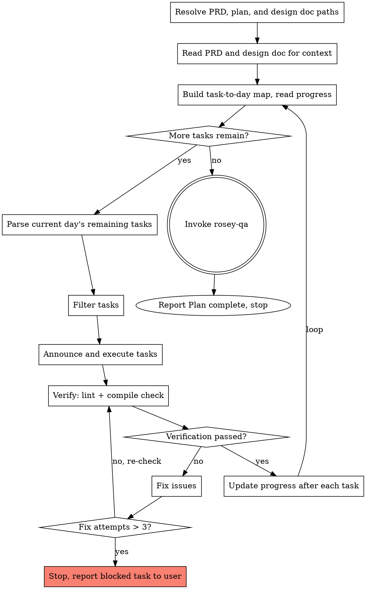

## Communication while using this skill

**Caveman lite** for all assistant prose while this skill runs: strip filler and hedging; keep articles and full sentences; stay professional and tight. Technical accuracy unchanged; quoted errors and code unchanged. Drop lite only for security warnings, irreversible confirmations, or when the user asks for normal or long-form wording.

# Rosey Developer

## Purpose

Given a PRD and its implementation plan, loop through all remaining days and execute them in sequence. For each day, announce the day's tasks and immediately execute them. After a day completes, automatically advance to the next day. The loop continues until the entire plan is done — no confirmation or approval is needed between days.

## Checklist

You MUST complete these in order:

1. **Resolve paths** — PRD, implementation plan, design doc, and **topology-path** must be known (from rosey-manager handoff, user, or glob in `docs/plans/<prd-slug>/`). Topology: `<plan-basename>.topology.json` beside the plan.
2. **Read PRD, design doc, and topology** — read all three for context. Use topology bottlenecks and [rosey-sentrux](../rosey-sentrux/SKILL.md) execution rules during implementation.
3. **Begin task loop** — build task-to-day map, read progress, compute next task/day, **maintain a running deduped list of every file path created or modified** (for final `FILES_CHANGED`; **all sibling repos** under the workspace — see **FILES_CHANGED (multi-repo)**; there is no Git diff), then repeat steps 4–11 until the plan is complete.
4. **Check tasks remain** — if the next task exceeds total task count, proceed to steps 12–13 (Sentrux gate, then rosey-qa).
5. **Parse day's section** — extract all tasks under the chosen day's header.
6. **Filter tasks** — exclude documentation, optional, and report/summary; keep implementation work **and** test tasks (see **Filtering Rules** and **Platform / GitOps (mandatory inclusion)**).
7. **Target-repo pre-pass** — before executing the day, scan filtered tasks for named repos / platform work and verify sibling clones exist (see **Target-repo pre-pass (each day)**).
8. **Announce and execute** — update progress: set `currentTask` to the first task index for this day (or the next task if resuming). Then briefly announce the day's tasks and immediately execute them. Do not switch to Plan Mode or wait for user approval.
9. **Verify** — after each task, run a lightweight verification (linter errors on changed files + compile/build check). If verification fails, fix and re-check (max 3 attempts; then stop and ask the user).
10. **Day completion gate** — before advancing the day, satisfy **Day completion gate (before next day)**.
11. **Advance** — update progress file, then loop back to step 3 for the next day.
12. **Sentrux handoff gate** — before rosey-qa: follow [rosey-sentrux](../rosey-sentrux/SKILL.md) and **Sentrux handoff gate (before QA)** below. If blocked, stop and do not invoke rosey-qa until sessions pass or user says **`override sentrux handoff block`**.
13. **Hand off to rosey-qa** — invoke the **rosey-qa** skill directly. Pass **`FILES_CHANGED`**, **`WHAT_WAS_IMPLEMENTED`**, **`PLAN_OR_REQUIREMENTS`** (PRD path), **`DESCRIPTION`**, optional **`CHANGE_SUMMARY`**, and **`SENTRUX_REVIEW_CONTEXT`** (from review brief; omit only if Sentrux was unavailable). Do not use `git diff`. Do not report "Plan complete" yourself; rosey-qa will do that after the review.

## Process Flow



**The terminal state is "Plan complete".** The skill loops through all remaining days automatically without pausing for confirmation. Do not create a daily plan until the next day has been determined and tasks have been parsed and filtered.

The diagram below is **simplified**: it omits **Target-repo pre-pass** (checklist step 7), **Day completion gate** (step 10), and **Advance** (step 11). Follow the **Checklist** section as source of truth.

## Inputs

- **prd-path**: Path to the PRD file (e.g. `docs/plans/<prd-slug>/YYYY-MM-DD-<prd-slug>-prd.md`).
- **plan-path**: Path to the implementation plan file (e.g. `docs/plans/<prd-slug>/YYYY-MM-DD-<prd-slug>-implementation-plan.md`).
- **design-doc-path**: Path to the design doc from rosey-brainstorm (e.g. `docs/plans/<prd-slug>/YYYY-MM-DD-<prd-slug>-design.md`). Provides architectural context — component boundaries, data flow, integration points. If not provided, look in `docs/plans/<prd-slug>/` for `*-<prd-slug>-design.md`.
- **prd-slug**: Used to locate the progress file and docs directory.
- **topology-path**: Path to `<plan-basename>.topology.json` (from rosey-manager handoff or derived from plan-path basename).

All paths should be provided explicitly (from the rosey-manager handoff or by the user). If any path is missing, look in `docs/plans/<prd-slug>/` for:

- PRD: `*-<prd-slug>-prd.md`
- Implementation plan: `*-<prd-slug>-implementation-plan.md`
- Design doc: `*-<prd-slug>-design.md`
- Topology: `<plan-basename>.topology.json` (same directory and basename as implementation plan)

Read the design doc and topology once at startup. If topology is missing, note it; do not block execution unless Sentrux gate applies at handoff.

## Test runner prerequisite

Before **creating** or **running** automated tests in this skill (aligns with rosey-manager plan rules):

- A **configured test manager** must exist in the **target repo** you touch (signals: `jest` / `vitest` / `playwright` / `cypress` in `package.json`; `pytest` with `pytest.ini` or `[tool.pytest]` / conventional `tests/`; `go test`; `cargo test`; `mix test`; equivalent for the stack).
- **If none is configured**, **do not** create test files and **do not** run verification item 3 (**Tests**); use lint + build only. **Do not** add ad hoc test tasks that the plan does not list.
- If the **implementation plan** lists test tasks but the repo has **no** such tooling, **skip** those tasks with a **documented reason** (e.g. `skipped: no pytest/jest configured in <repo>`), do not invent ad hoc test harnesses, and continue with implementation tasks. Surface this at least once so the user can add tooling later.

## Determining the Next Task and Day

1. **Progress file**: In the **same directory as the implementation plan**, look for a progress file named `<plan-basename>.progress.json` (e.g. `2025-02-19-subscription-cancellation-implementation-plan.progress.json`). If it exists, read `lastCompletedTask` (number). Otherwise treat as no task executed.
2. **Build a task-to-day map**: Parse the plan and number all tasks sequentially across days (Day 1 bullet 1 = task 1, Day 1 bullet 2 = task 2, Day 2 bullet 1 = task 3, etc.). Use this map to determine which day any given task belongs to.
3. **Next task index**:
   - If no progress file or `lastCompletedTask` is 0 or missing → **next task = 1** (Day 1).
   - If `currentTask` is present → **resume that task** (partial recovery — see "Progress After Execution").
   - Otherwise → **next task = lastCompletedTask + 1**.
4. Use the task-to-day map to determine which day the next task belongs to.
5. If the next task index exceeds the total task count, the implementation plan is **complete**. Run **Sentrux handoff gate** (step **12**), then invoke **rosey-qa** (step **13**; see **Final Code Review** below).

## Parsing the Plan

- Plan sections use headers like `## Day 1`, `## Day 2`, or `## Day 1: Title`.
- Under each day, tasks may appear as:
  - Checklist items: `- [ ] Task` or `- [x] Task`.
  - Numbered or bullet lists under a "Tasks" or "Goal" subsection.
- Extract every task listed under the chosen day's section (including subsections like "### Tasks"). Treat each bullet or numbered item as one task.

## Filtering Rules for the Daily Plan

rosey-manager may include test tasks when rule 2’s prerequisite is met. These filters are a **defensive guard** for **non-implementation** items that slip through. If you find yourself filtering many tasks, the upstream plan may need revision.

When building the plan for the day, **exclude**:

- Any task that is **documentation** (README, API docs, user guides, setup guides, markdown docs). **Infrastructure manifests** are not prose docs — see **Platform / GitOps (mandatory inclusion)**.
- Any task marked **optional** or "if time permits" or "consider".
- Any task that is a **report, summary, or retrospective** at the end of the day.

**Include** implementation work and **test** tasks. **Test** tasks that you must **skip** (no test runner — see **Test runner prerequisite**) still count as handled for the day when the skip is **documented**; do not execute or create tests in that case.

**Empty day after filtering:** If all tasks in a day are filtered out, mark the day as complete in the progress file and automatically advance to the next day. Do not present an empty plan to the user.

## Platform / GitOps (mandatory inclusion)

**Code-as-platform:** Tasks that describe **deployment patches / Secret or ConfigMap env / cluster configuration** are **mandatory implementation** — the same weight as application `src/` work. **Do not** skip them because they are not "feature code."

**Documentation filter (strict):** Exclude only **prose documentation** (README, API docs, user guides, setup guides, **author-only** markdown under `docs/` when the task is purely writing narrative). **Infrastructure manifests** (`*.yaml`, `*.yml`, `*.json`) are **not** documentation — never drop them via the documentation exclusion.

## Path pre-pass (each day)

Run **after** step 6 (**Filter tasks**) and **before** step 8 (**Announce and execute**):

1. Scan **filtered tasks** for paths and verify they belong to the current project context.
2. If a task **requires** edits in a path that does not exist and isn't intended to be created, **stop** and report **blocked**.

## FILES_CHANGED

Maintain **`FILES_CHANGED`** as a **deduped list of every file path created or modified** during the plan:

- Use paths **relative to the workspace root**.
- **rosey-qa** MUST receive this **full combined list** so review can detect missing edits.

## Sentrux sessions (per repo)

Follow [rosey-sentrux](../rosey-sentrux/SKILL.md). Track repos in optional `sentruxSessions` on the progress file.

**First task that touches a repo in this plan run:**

1. MCP `session_start` on that repo root (skip if `sentruxSessions` already has `"started"` for that repo — crash recovery).
2. Before large edits in that repo: MCP `git_stats` (hotspots) and `dsm` (dependency direction). Do not drive-by edit hotspot files unless the plan bullet requires it.

**Execution rules** (state in day announcement, 1–2 lines when Sentrux is available):

- Extend existing modules over new cross-cutting files unless the plan requires otherwise.
- New imports: follow DSM layer direction; avoid cycles called out in topology.
- Respect topology bottleneck (e.g. equality → no new god files).

## Sentrux handoff gate (before QA)

After all tasks complete, **before** step 13 (rosey-qa):

1. For each repo with an active session: MCP `session_end`.
2. MCP `test_gaps` for paths in `FILES_CHANGED` under that repo.
3. Write `docs/plans/<prd-slug>/<plan-basename>.sentrux-review-brief.json` per rosey-sentrux schema.
4. If any session has `pass: false` and no user override (`override sentrux handoff block` recorded in brief) → **stop**; report signal deltas and bottlenecks; do **not** invoke rosey-qa.
5. If all pass, override recorded, or Sentrux unavailable → build **`SENTRUX_REVIEW_CONTEXT`** markdown from the brief and proceed to rosey-qa.

Remediation loop: fix structural issues, re-run `session_end` until pass or user override.

## Output: Daily Announcement and Execution

1. **Announce the day**: Print a brief header (e.g. "Day N: [Day title if present]") followed by a short numbered list of the tasks to be executed. When Sentrux is active, add 1–2 lines on execution rules / bottleneck for repos touched today. Keep it concise — this is an announcement, not a proposal.
2. **Execute immediately**: Begin executing the tasks right away. Do not switch to Plan Mode or wait for user approval.
3. **Steps**: One step per filtered task. Phrase each step as a single, actionable item. All steps are **mandatory**; do not label any as optional.
4. **No extra docs steps**; **test steps** from the plan are mandatory like any other task **unless** **Test runner prerequisite** forces a documented skip (then no test files and no item 3 verification).
5. **No final reports or summaries**: Do not add "Write summary", "Create report", or "Retrospective".
6. **Progress update**: The agent MUST update the progress file after each task (set `lastCompletedTask` to the global task index, remove `currentTask`). Before starting each task, set `currentTask` to its global index. After each task, **append any new paths** to the running **`FILES_CHANGED`** list (**multi-repo** — see **FILES_CHANGED (multi-repo)**) (dedupe).

## Verification After Each Task

After executing each task and before marking it complete in the progress file, run a lightweight verification:

1. **Lint check** — run the linter on all files changed by the task (use the ReadLints tool or equivalent). Only check files you just created or modified.
2. **Compile/build check** — run the project's build or compile command (e.g. `go build ./...` for Go, `npm run build` or `npx svelte-check` for frontend). The goal is to catch syntax errors, type errors, and import issues.
3. **Tests (when the task is test work)** — **only if** **Test runner prerequisite** is satisfied for that repo. Run the project's **targeted** test command for that scope (e.g. `pytest path/to/test_file.py`, `npm test -- path/to/spec`). If no runner is configured, omit this step entirely for that task.

**If verification fails:**

- Read the errors and fix them immediately. This is part of the task, not a separate task.
- Re-run the failing check after the fix to confirm it passes.
- Only after verification passes, update the progress file and advance.
- **Circuit breaker:** Track fix attempts per task. If a task exceeds **3 fix attempts** and verification still fails, stop and report the blocked task to the user. List the unresolved errors and ask how to proceed (skip the task, provide guidance, or abort the plan). Only continue after the user responds.

**If verification passes:** update the progress file normally and advance to the next task.

**Scope:** Verification stays lightweight for pure implementation tasks (lint + build). For **test** tasks with a configured runner, targeted tests (item 3) apply. If **Test runner prerequisite** fails, skip item 3 and do not author tests. Do not run the **full** test suite on every task unless the plan requires it or there is no narrower command.

## Day completion gate (before next day)

After **all** filtered tasks for the day have executed and passed **Verify** (step 9), **before** step 11 (**Advance**):

1. **Bullet coverage:** For each **filtered task / bullet** of that day, there must be either **at least one** matching path prefix in **`FILES_CHANGED`** from this day's work, or an explicit **documented skip/block reason** (user-visible).
2. **Incomplete detection:** If work was required but **`FILES_CHANGED`** does not reflect it and there is **no** documented skip for the bullets, **do not** advance to the next day — treat the day as **incomplete**, execute or unblock the missing work first.

If the gate fails, fix or unblock before advancing; only then update **`lastCompletedTask`** for the day's final task and proceed.

## Day Complete — Advancing to Next Day

After the **Day completion gate** passes and the progress file is updated for the last task of the day, **automatically loop back**: read the progress file, compute the next day, and continue. If the next day exists, run **Target-repo pre-pass** then announce its tasks and execute immediately. If not, proceed to **Hand off to rosey-qa**.

Do not stop between days except when **blocked** (missing clone, gate failure). Do not ask the user whether to continue for normal progression. Do not switch to Plan Mode. The loop is fully automatic with no checkpoints except **blocked** states.

## Progress After Execution

The progress file uses **global task numbering**. Path: same directory as the implementation plan, filename `<plan-basename>.progress.json`.

**Structure:**

```json
{
  "lastCompletedTask": 4,
  "currentTask": 5,
  "sentruxSessions": {
    "src/": "started"
  }
}
```

- `lastCompletedTask`: the index (1-based) of the last fully completed task. Tasks are numbered sequentially across all days (Day 1 bullet 1 = task 1, Day 1 bullet 2 = task 2, Day 2 bullet 1 = task 3, etc.).
- `currentTask`: the task currently in progress (present only if a task is partially complete).
- `sentruxSessions` (optional): repo path → `"started"` after `session_start`; used for crash recovery.

**Update rules for the executing agent:**

1. **Before starting a task:** set `currentTask` to the global task index.
2. **After a task completes:** set `lastCompletedTask` to the task index, remove `currentTask`.

**Partial day recovery:** When rosey-developer reads the progress file and finds `currentTask`, use the task-to-day map to determine which day that task belongs to. Generate the daily plan for that day but skip already-completed tasks (any task with index ≤ `lastCompletedTask`). Only execute remaining tasks in the day, then continue to the next day.

## Final Code Review

The workspace root is **not** treated as a Git repo for this flow. There is **no** `git diff` baseline.

After all tasks are complete, run **Sentrux handoff gate (before QA)**. If not blocked, hand off to **rosey-qa**:

1. **Assemble `FILES_CHANGED`:** every path you created or modified across the plan (from the running list maintained in the task loop). Paths should be relative to the workspace or unambiguous.
2. **Optional `CHANGE_SUMMARY`:** if some files are large, add brief per-file notes (what changed, line ranges, or short excerpts) so the reviewer can focus; otherwise omit or leave brief.
3. **`SENTRUX_REVIEW_CONTEXT`:** markdown summary from `sentrux-review-brief.json` (see rosey-sentrux). Required when brief exists and Sentrux was available.
4. Invoke the **rosey-qa** skill directly, passing:
   - `WHAT_WAS_IMPLEMENTED`: summary of the full implementation across all days
   - `PLAN_OR_REQUIREMENTS`: the PRD path
   - `FILES_CHANGED`: the assembled list (comma- or newline-separated)
   - `DESCRIPTION`: "[prd-slug] full implementation"
   - `CHANGE_SUMMARY`: optional; per-file change notes as above
   - `SENTRUX_REVIEW_CONTEXT`: structural session deltas and test_gaps

Do not report "Plan complete" yourself. **rosey-qa** will perform the review, fix the issues, and report completion.

## Plan Complete

(This step is handled by **rosey-qa** after the handoff. You do not need to do this.)

## Git Policy

**No Git baseline** is assumed for code review; use **tracked file paths** and the **code-reviewer** template instead of `git diff`.

If a Git repo exists somewhere useful for context, read-only commands (`git status`, `git log`, etc.) are allowed. **Forbidden:** `git commit`, `git push`, `git add`, or anything that modifies repository state. Only write project files as the plan requires. The user manages commits themselves.

## Workflow Summary

1. Resolve PRD, implementation plan, design doc, and topology paths (glob in `docs/plans/<prd-slug>/` if missing).
2. Read the PRD, design doc, and topology for context (acceptance criteria, edge cases, constraints, architecture, Sentrux bottlenecks).
3. Build task-to-day map (number all tasks globally across days). Read progress file (if any) and compute next task/day. Maintain **`FILES_CHANGED`**.
4. If the next task exceeds the total task count, run **Sentrux handoff gate**, then invoke **rosey-qa** and stop (plan execution complete).
5. Parse the current day's section and extract remaining tasks (skip any with index ≤ `lastCompletedTask`).
6. Filter out prose documentation, optional, and report/summary tasks — **keep** implementation, **tests**, and platform/GitOps tasks.
7. **Path pre-pass:** verify required paths exist or **block**.
8. Update progress: set `currentTask` to the first task index for the day (or next task when resuming). Announce the day's tasks and execute them.
9. After each task, verify (lint changed files + compile/build check). Fix any errors before advancing (max 3 fix attempts per task; then stop and ask the user).
10. Update progress after each verified task: set `lastCompletedTask` to the task index, remove `currentTask`. Append paths to **`FILES_CHANGED`**.
11. When all tasks in the day are done, run the **Day completion gate**; then loop back to step 3 for the next day.
12. When no tasks remain, run **Sentrux handoff gate (before QA)**; if not blocked, invoke **rosey-qa** with **`FILES_CHANGED`**, optional **`CHANGE_SUMMARY`**, and **`SENTRUX_REVIEW_CONTEXT`** — not `git diff`. Do not report "Plan complete" yourself; rosey-qa will do that after the review.
