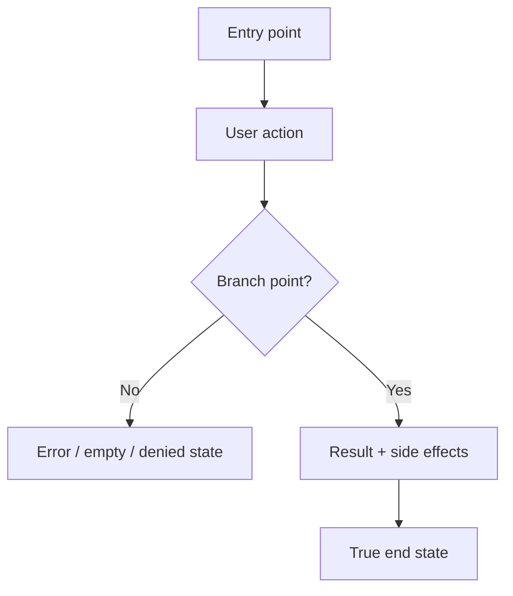

# Dogfood Report — <window>

> Window-scoped browser QA of shipped work. Generated by `rosey-dogfood` on <YYYY-MM-DD>.
Intake: <7d | YYYY-MM-DD..YYYY-MM-DD | PR list>. Target: <local | staging | prod>.

<!-- Use repo-relative paths throughout this doc, never absolute paths, so it stays portable. --> <!-- This template is the source of truth for the report's sections; build the report to this shape rather than from memory. -->

## Window & intake

- **Window slug:** `<window-slug>`
- **Repo:** `<owner/repo>`
- **Merged PRs fetched:** <N>
- **Skipped (not merged / trivial):** <N>
- **Target URL:** `<base url>`
- **Matrix confirm:** reviewed | unreviewed (non-interactive)

<One short paragraph: what shipped in this window, in user language. 2–6 bullets of clustered journeys, not a PR inventory.>

## Out of scope

| PR | Title | Reason |
| --- | --- | --- |
| # | | |

"None" if every fetched PR entered a cluster.

## Personas

<The primary personas the flows were judged against, and what each cares about. Note the source: STRATEGY.md Users, PRODUCT.md, VISION.md, a persona doc, or "inferred".>

- **<Persona name>** — <job-to-be-done / what they care about> — <source>

## Flows tested

<One Mermaid flowchart per distinct user journey the clusters touch. Include happy path and branch points (validation error, empty, permission-denied), side effects (emails, jobs, notifications), and the true end state — including click-through destinations. Clustered, not one chart per PR.>

## Test Matrix & Results

| # | Flow | Journey / Scenario | PRs | Status | Issue |
| --- | --- | --- | --- | --- | --- |
| 1 | | | #412 #418 | Pending | - |
| 2 | | | #421 | Pass | - |
| 3 | | | #412 | Fail | <short symptom> |
| 4 | | | — | Blocked (needs human verify) | |

Status values: `Pending`, `Pass`, `Fail`, `Skipped`, `Blocked (needs human verify)`. Start every scenario at `Pending` so this table doubles as the resume checkpoint. Originating PRs are the cluster's PRs; adjacent-regression rows may use `—`.

## Failures

For each scenario with status `Fail`:

### <Short issue title> — scenario #<n>
- **Symptom:** <what the user saw / what failed in the browser>
- **Expected:** <what should have happened>
- **Actual:** <what happened>
- **Evidence:** <repo-relative screenshot path if embedded, console/network note, URL>
- **Suggested follow-up:** <ticket-sized next step; do not implement here>

"None" if the matrix has no `Fail` rows.

## Paper Cuts (by persona)

<Experiential friction found while walking each flow as each persona. A scenario can `Pass` functionally and still carry paper cuts. Note the persona, severity, and that v1 defers every paper cut (no auto-fix). "None" if clean.>

- **<Persona>** — <paper cut> — <severity> — deferred

## Console Errors

<Any console or network errors observed, and whether they blocked a scenario. "None" if clean.>

## Human Verifications

<External-interaction legs (OAuth, real email delivery, payments, SMS) and prod mutations this run must not drive: confirmed, pending, or not applicable.>

## Decisions for a Human

<Product or UX trade-offs noticed while dogfooding — competing interpretations, missing empty states, permission questions. Not a fix queue. "None" if nothing needs a human call.>

### <Short title>
- **What's going on:** <symptom / failing or awkward scenario>
- **Why a human:** <ambiguity, product trade-off, missing test account, external system>
- **Options:** <option A (trade-offs) / option B (trade-offs)>
- **Recommendation:** <suggested direction>

## Final Status

<Overall verdict for the shipped window: ready as shipped / ready with caveats / not ready. Name outstanding `Fail` and `Blocked` items. Do not chase the automated suite in this run.>
