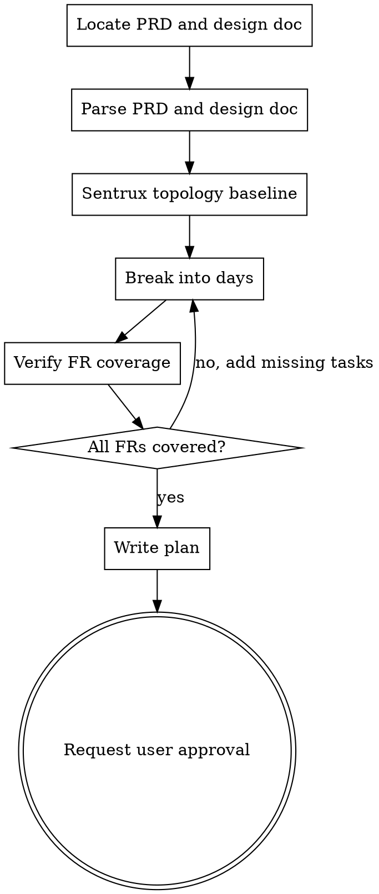

## Communication while using this skill

**Caveman lite** for all assistant prose while this skill runs: strip filler and hedging; keep articles and full sentences; stay professional and tight. Technical accuracy unchanged; quoted errors and code unchanged. Drop lite only for security warnings, irreversible confirmations, or when the user asks for normal or long-form wording.

# PRD to Implementation Plan

## Prerequisites

**Do not create a plan without a PRD document.** The PRD path is normally passed from rosey-product (via the handoff values `prd-slug`, `prd-path`, and `design-doc-path`). If those are not available, ask the user for the PRD path or content. If no PRD is given, stop.

**Read the design doc too.** The design doc (from rosey-brainstorm) contains architectural decisions — component boundaries, data flow, integration points — that the PRD's "Technical Approach" section only summarizes. Use `design-doc-path` from the rosey-product handoff. If not available, look in `docs/plans/<prd-slug>/` for `*-<prd-slug>-design.md`. If no design doc exists, proceed with the PRD alone but note that task ordering and scoping may be less precise.

## Output Location

Write the plan to **docs/plans/<prd-slug>/YYYY-MM-DD-<prd-slug>-implementation-plan.md** (same directory as the PRD). Use the date when the plan is written and the same prd-slug as the PRD. Example: for PRD `docs/plans/subscription-cancellation/2025-02-19-subscription-cancellation-prd.md`, write to `docs/plans/subscription-cancellation/2025-02-20-subscription-cancellation-implementation-plan.md`.

## Checklist

You MUST complete these in order:

1. **Locate or receive the PRD and design doc** — use `prd-path` and `design-doc-path` from rosey-product handoff; if not available, ask the user or glob in `docs/plans/<prd-slug>/`; if no PRD, stop.
2. **Parse the PRD and design doc** — from the PRD extract goals, scope, acceptance criteria, technical constraints; from the design doc extract architecture, component boundaries, data flow, and integration points.
2b. **Sentrux topology baseline** — read [rosey-sentrux](../rosey-sentrux/SKILL.md); call MCP **`scan`** then **`health`** for the repository workspace root via `CallMcpTool` (**never** CLI `sentrux scan` — it opens the GUI); write `<plan-basename>.topology.json`; use bottleneck + planning notes when scoping days.
3. **Break into days** — assign day numbers, list mandatory implementation tasks and **test tasks only where rule 2’s test-runner prerequisite is met**, respect dependencies. Use the design doc's architecture **and Sentrux topology** to inform task ordering and scoping (e.g., shared models before controllers, data layer before UI; Day 1 aligned to the worst bottleneck in the repository).
4. **Verify FR coverage** — check that every Functional Requirement (FR-*) from the PRD is addressed by at least one task. List any uncovered FRs and add tasks for them.
5. **Write the plan** — save to `docs/plans/<prd-slug>/YYYY-MM-DD-<prd-slug>-implementation-plan.md`.
6. **Stop and request user approval** — announce the plan path, summarize the day-by-day structure, and explicitly ask the user to approve the plan before any implementation begins. Do not invoke rosey-developer or write any code until the user approves.

## Process Flow



**The terminal state is requesting user approval.** Do not write the plan until the PRD and design doc are located and parsed and all FRs are covered. Do not invoke rosey-developer or write any implementation code until the user explicitly approves the plan.

## Plan Rules

1. **All steps are mandatory.** No optional steps, no "consider doing X", no alternatives. Every task is required.
2. **Tests only with a configured test runner.** Include tasks for **automated tests** (unit, integration, e2e, contract) only if a **configured test manager** **already** exists (tooling you can run — not ad hoc scripts). Before writing the plan, infer from the workspace (or PRD stack notes): e.g. **JavaScript/TypeScript:** `jest`, `vitest`, `mocha`, or Playwright/Cypress in `package.json` (`scripts.test`, `devDependencies`). **Python:** `pytest` (and `pytest.ini` / `[tool.pytest]` in `pyproject.toml` / tests layout). **Go:** standard `go test`. **Rust:** `cargo test`. **Elixir:** `mix test`. **Other stacks:** analogous obvious config. If the repository has no test runner configured, **do not** plan test creation — implementation-only (QA via rosey-qa / manual remains). When tests are in scope, name the area or files (e.g. `tests/test_orders.py`, `*.spec.ts`).
3. **No documentation steps.** Do not include README, API docs, user guides, or summary documents (prose-only deliverables).
4. **No reports or summaries at the end.** The plan ends with the last implementation task. No "Day N: Write summary" or "Create report".
5. **Day-to-day granularity.** "Day" is a logical grouping of related tasks, not a time estimate or literal calendar day. Each day has concrete, actionable tasks an AI agent can execute. Order tasks so dependencies come first.

## Workflow

1. **Locate or receive the PRD and design doc.** Use `prd-path` and `design-doc-path` from the rosey-product handoff. If not available, ask the user or glob in `docs/plans/<prd-slug>/` for `*-<prd-slug>-prd.md` and `*-<prd-slug>-design.md`. If no PRD is found, stop. If no design doc is found, proceed with the PRD alone.
2. **Parse the PRD and design doc.** From the PRD, extract:
   - Goals and success criteria
   - Features and scope
   - Acceptance criteria / requirements
   - Technical constraints, stack, or architecture notes
   From the design doc (if available), extract:
   - Architecture and component boundaries
   - Data flow and integration points
   - Key technical decisions and their rationale
2b. **Sentrux topology baseline.** Follow [rosey-sentrux](../rosey-sentrux/SKILL.md): MCP **`scan`** + **`health`** for the workspace root repository (not terminal `sentrux scan`); write `docs/plans/<prd-slug>/<plan-basename>.topology.json`. If Sentrux MCP/binary unavailable, still write topology with `status: "unavailable"` for the repository.
3. **Break into days.** For each logical unit of work:
   - Assign a day number (Day 1, Day 2, …).
   - List implementation tasks (code, config, data, integration, **tests** only if rule 2’s test-runner prerequisite is met) as needed. No prose-only docs, no summaries.
   - Make each task specific: what to build, which files/areas, and what "done" looks like.
   - Use the design doc's architecture **and topology bottlenecks** to inform task scoping — respect component boundaries (don't mix unrelated components in one task) and place shared/foundational work (models, services, config) before dependent work (controllers, UI).
   - Align **Day 1** with the worst bottleneck in the repository; add a short **Sentrux note** on bullets when it prevents structural regression (not a separate mandatory task).
4. **Respect dependencies.** Order days so that prerequisites (e.g. data model, API) come before dependents (e.g. UI, flows). The design doc's data flow is the primary guide for ordering.
5. **Verify FR coverage.** Extract all Functional Requirements (FR-1, FR-2, ...) from the PRD. For each FR, confirm at least one task in the plan addresses it. If any FR is not covered, add tasks for it in the appropriate day. This step is mandatory — do not write the plan until every FR is accounted for.
6. **Write the plan.** Create `docs/plans/<prd-slug>/YYYY-MM-DD-<prd-slug>-implementation-plan.md` (same directory as the PRD) with the structure below.

## Plan Document Structure

Use this structure in the output file:

```markdown
# Implementation Plan: [Feature/PRD name]

**Source PRD:** [path or name of PRD file]
**Source Design Doc:** [path or name of design doc file, or "N/A"]
**Topology:** [path to `<plan-basename>.topology.json`]
**Execution:** sequential (rosey-developer)

## Architecture baseline (Sentrux)

| Repo | Signal | Bottleneck | Planning guidance |
| [workspace-relative repo path] | [quality_signal or N/A] | [bottleneck or N/A] | [one line from topology planning_notes] |

(Omit numeric columns if Sentrux was unavailable; state that in the table caption.)

## Day 1

- [Task 1: specific deliverable]
- [Task 2: specific deliverable]

## Day 2

- [Task 1]
- [Task 2]

## Day N

- [Task 1]
- ...
```

- Use `## Day N` headers only. No "Phase" or "Week" unless the user's PRD explicitly uses them; if so, keep day-level tasks under each.
- Each bullet is one mandatory task (implementation or **test**, the latter only when a test runner is configured per rule 2). Be concrete (e.g. "Add `POST /api/orders` in `orders_controller.go` with validation" or "Add pytest coverage for `request_cancellation` edge cases" not "Implement API" or vague "Add tests").
- No final section for "Summary", "Retrospective", or "Report".

## Task Quality

- **Actionable:** An agent can do the task without guessing (e.g. "Add `status` enum to `Subscription` model and run migration").
- **Scoped:** One task = one clear deliverable. Split large work into multiple tasks across days if needed.
- **Mandatory:** If it's in the plan, it must be done. Do not add "optional" or "if time permits" items.

## Example (excerpt)

**PRD:** "Add subscription cancellation with 30-day grace period."

**Plan excerpt:**

```markdown
# Implementation Plan: Subscription cancellation with grace period

**Source PRD:** docs/plans/subscription-cancellation/2025-02-19-subscription-cancellation-prd.md
**Source Design Doc:** docs/plans/subscription-cancellation/2025-02-19-subscription-cancellation-design.md
**Topology:** docs/plans/subscription-cancellation/2025-02-20-subscription-cancellation-implementation-plan.topology.json
**Execution:** sequential (rosey-developer)

## Architecture baseline (Sentrux)

| Repo | Signal | Bottleneck | Planning guidance |
| src/api | 7200 | modularity | Day 1: add code inside existing service modules, not new top-level packages |

## Day 1

- Add `cancellation_requested_at` (nullable timestamp) and `cancellation_effective_at` (nullable timestamp) to subscriptions table; create and run migration.
- Add `RequestCancellation(subscriptionID, effectiveAt)` to subscription service and persist both timestamps.

## Day 2

- Expose `POST /api/subscriptions/:id/request-cancellation` with body `{ "effective_at": "ISO8601" }`; validate effective_at is within allowed window (e.g. ≤90 days).
- Add scheduled job (or cron) that lists subscriptions where `cancellation_effective_at <= NOW()` and sets status to `cancelled`; run job once and verify.

## Day 3

- Add "Request cancellation" action to subscription detail UI; call new API and show confirmation with effective date.
- Update subscription list and detail views to show "Cancellation requested (effective &lt;date&gt;)" when `cancellation_requested_at` is set.
```

No Day 4 "Write summary" or "Document API"; plan ends after Day 3.

## Git Policy

**Allowed:** read-only git operations (`git status`, `git diff`, `git log`) for context and review.
**Forbidden:** `git commit`, `git push`, `git add`, or any command that modifies the repository. Only write files to disk. The user manages commits themselves.

## Approval Gate

**Stop after writing the plan. Do not begin implementation until the user approves.**

After saving the plan:

1. Announce the plan path to the user.
2. Summarize the plan: number of days and a one-line description of each day's focus. Include one Sentrux line when topology is available (e.g. *"Sentrux bottleneck: equality in UI — Day 1 scoped to extend existing components."*).
3. Explicitly ask the user to review the plan and approve it, or request changes. Example prompt: *"The plan is saved at `<plan-path>`. Topology baseline: `<topology-path>`. Please review and approve before rosey-developer."*
4. **Do not** invoke rosey-developer, write code, run commands that modify the repo, or start any implementation step while waiting for approval.
5. If the user requests changes, update the plan file in place and re-request approval.

## Execution Handoff (only after approval)

Once the user explicitly approves the plan, invoke the rosey-developer skill (read its SKILL.md and follow it) with these handoff values:

- **prd-slug**: `<prd-slug>`
- **prd-path**: `<actual prd path>`
- **plan-path**: `<actual plan path>`
- **design-doc-path**: `<actual design doc path>`
- **topology-path**: `docs/plans/<prd-slug>/<plan-basename>.topology.json`

This plan format is for sequential execution via rosey-developer only.
