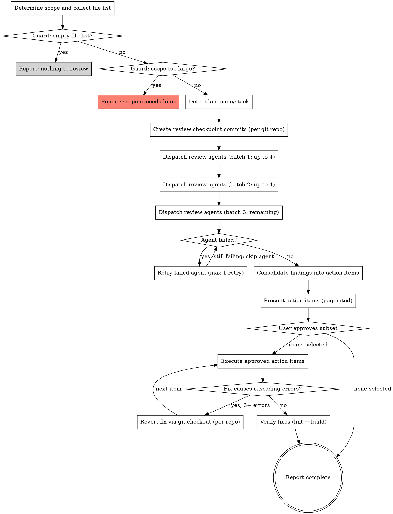

## Communication while using this skill

**Caveman lite** for all assistant prose while this skill runs: strip filler and hedging; keep articles and full sentences; stay professional and tight. Technical accuracy unchanged; quoted errors and code unchanged. Drop lite only for security warnings, irreversible confirmations, or when the user asks for normal or long-form wording.

# Rosey Prerelease

High-level product quality gate. Dispatch specialist review agents against a set of changed files, consolidate findings into a single prioritized action-item list, obtain user approval, then execute approved items.

**rosey-prerelease vs rosey-qa:** **rosey-qa** is for per-task and incremental reviews during development — quick, single-agent, low overhead, often after **rosey-developer** handoff. **rosey-prerelease** is the final quality gate before finishing a full feature or publishing a release — multiple specialist agents, comprehensive analysis, higher cost, higher confidence.

## Review Agents

The following agents live in `.cursor/agents/` (this workspace) and are dispatched as `generalPurpose` subagents via the Task tool with `readonly: true`:

| Agent | Focus | Language/Stack |
|-------|-------|----------------|
| `accessibility-auditor.md` | WCAG conformance, ARIA, keyboard navigation, color contrast | Frontend only |
| `architecture-strategist.md` | Architectural patterns, SOLID, coupling, boundaries | Any |
| `code-simplicity-reviewer.md` | YAGNI, unnecessary complexity, LOC reduction | Any |
| `css-quality-reviewer.md` | Responsive design, layout stability, specificity, CSS maintainability | Frontend only |
| `i18n-readiness-reviewer.md` | Hardcoded strings, locale formatting, RTL support, translation readiness | Frontend only |
| `kieran-typescript-reviewer.md` | TypeScript type safety, naming, modern patterns | TypeScript only |
| `pattern-recognition-specialist.md` | Design patterns, anti-patterns, duplication, naming consistency | Any |
| `performance-oracle.md` | Algorithmic complexity, N+1 queries, memory, caching | Any |
| `security-sentinel.md` | Input validation, injection, auth/authz, secrets, OWASP | Any |

## When to Use

- Before finishing a full feature (final quality pass)
- Before publishing a new version or release
- Before merging a large branch into main
- When comprehensive quality assurance is needed across multiple dimensions

**Do NOT use for:** per-task reviews, quick checks, or incremental development feedback — use **rosey-qa** for those.

## Inputs

- **scope** — One of:
  - `"diff"` — review uncommitted changes in the repository (default when no scope given)
  - `"staged"` — review staged changes in the repository
  - `"files:path1,path2,..."` — review specific files (paths relative to workspace root)
  - `"dir:path/to/directory"` — review all files in a directory
- **files-changed** (optional) — comma-separated or newline-separated file list (e.g. from **rosey-developer** `FILES_CHANGED`). When provided without **scope**, treated as `files:...`.
- **sentrux-review-context** (optional) — markdown from `sentrux-review-brief.json` / [rosey-sentrux](../rosey-sentrux/SKILL.md). Injected into every agent prompt when present.
- **skip-agents** (optional) — comma-separated agent names to exclude (e.g. `"security-sentinel,performance-oracle"`)
- **build-command** (optional) — explicit build verification command (e.g. `"npm run build"`, `"make check"`). Overrides auto-detection in step 9. Run from the workspace root directory.

**Default:** If neither **scope** nor **files-changed** is provided, default to `"diff"` (`git diff HEAD`).

## Process



## Checklist

Complete these steps in order:

### 1. Determine Scope

Resolve the file list based on the scope input (paths **relative to workspace root** unless noted):

- **`files-changed` only** → treat as `files:path1,path2,...`.
- **`"files:..."`** → use listed paths; skip any that don't exist on disk (treat as deleted). Read each existing file from disk.
- **`"dir:..."`** → `find <dir> -type f`, excluding: `node_modules/`, `.git/`, `dist/`, `build/`, `__pycache__/`, `vendor/`, `.next/`, `coverage/`. Read each file.
- **`"diff"`** →
  - `git diff HEAD --name-only` and `git ls-files --others --exclude-standard` to capture changed and untracked files
  - `git diff HEAD --diff-filter=D --name-only` for **deleted** files
  - `git diff HEAD` for the diff representation
  - Read full contents of each non-deleted file
- **`"staged"`** → same as diff but use `--cached` variants (e.g. `git diff --cached`).

**Deleted files** appear in the diff but have no contents. Include them in `{FILE_LIST_FOR_THIS_AGENT}` with `(deleted)`; omit from `{FULL_FILE_CONTENTS}`.

**Filter non-text files** — remove binary extensions: `.png`, `.jpg`, `.jpeg`, `.gif`, `.ico`, `.webp`, `.woff`, `.woff2`, `.ttf`, `.eot`, `.mp3`, `.mp4`, `.zip`, `.tar`, `.gz`, `.pdf`, `.map`. Exclude lockfiles: `package-lock.json`, `yarn.lock`, `pnpm-lock.yaml`, `Gemfile.lock`, `poetry.lock`, `go.sum`, `Cargo.lock`. Keep `.svg`.

Store for agent prompts:

1. **File list** — all paths under review (including deleted, annotated).
2. **Diff** — unified diff (diff/staged only; omit for files/dir).
3. **Full file contents** — complete source of each non-deleted, non-binary file.
4. **Deleted files** — paths for diff analysis.

### 2. Guard: Empty File List

If the file list is empty after step 1, report and stop:

> **No changes to review.** Provide `files-changed`, `files:...`, or `dir:...`. For git scopes, ensure the workspace repository has uncommitted changes.

### 3. Guard: Scope Size Limit

**For `"diff"` and `"staged"`** — count diff lines:

- **> 3000 diff lines** or **> 50 files** → refuse.

**For `"files:..."` and `"dir:..."`** — count total lines across file contents:

- **> 10000 total lines** or **> 50 files** → refuse.

Report:

> **Scope too large for rosey-prerelease** ([N] lines across [M] files). Use a smaller `files:` list or `dir:` subset, or split into multiple review passes.

### 4. Detect Language and Stack

Use file extensions in the review scope:

| Extensions | Language |
|------------|----------|
| `.ts`, `.tsx` | TypeScript |
| `.js`, `.jsx`, `.mjs` | JavaScript |
| `.py` | Python |
| `.rb`, `.erb` | Ruby |
| `.go` | Go |
| `.rs` | Rust |
| `.java`, `.kt` | JVM |
| `.css`, `.scss`, `.less`, `.sass` | CSS |

**Frontend presence:** any of `.tsx`, `.jsx`, `.vue`, `.svelte`, `.html`, `.css`, `.scss`, `.less`, `.sass`.

**Agent filtering:**

- `kieran-typescript-reviewer` → if `.ts`, `.tsx`, `.vue`, or `.svelte` in scope; else skip. When dispatched, only those extensions in its prompt.
- `accessibility-auditor`, `css-quality-reviewer`, `i18n-readiness-reviewer` → if frontend detected; else skip. Frontend files only in their prompts.
- Other agents → all files in scope (unless **skip-agents**).

### 5. Create Review Checkpoint Commits

Create a checkpoint commit in the workspace root git repository:

**For `"staged"` scope** — commit only what is already staged:

```bash
git commit --no-verify -m "rosey-prerelease: review checkpoint (pre-review snapshot)"
```

Do **not** run `git add`.

**For `"diff"`, `"files:..."`, and `"dir:..."`** — stage only files under review:

```bash
git add <file1> <file2> ... && git commit --no-verify -m "rosey-prerelease: review checkpoint (pre-review snapshot)"
```

Do **not** use `git add -A`. Use `--no-verify` on checkpoint commits only.

Record the **checkpoint SHA** for the completion report. Reverts during fix execution use `git checkout HEAD -- <path>` where HEAD is the checkpoint commit.

### 6. Dispatch Review Agents

Read each agent from `.cursor/agents/<name>.md` before dispatching. Dispatch as `generalPurpose` with `readonly: true`. Up to 4 per batch.

**Batch 1:** architecture-strategist, code-simplicity-reviewer, pattern-recognition-specialist, security-sentinel

**Batch 2:** performance-oracle, kieran-typescript-reviewer (if TS), accessibility-auditor (if frontend), css-quality-reviewer (if frontend)

**Batch 3:** i18n-readiness-reviewer (if frontend)

If agents are skipped, pull forward from later batches (max 4 per batch).

**Prompt template:**

```
You are a specialist code reviewer. Review the following code changes using your expertise.

IMPORTANT: Your review is based ONLY on the code provided below. Do not attempt to run shell commands,
search the filesystem, or use external tools — you do not have access. Analyze the provided code directly.

## Your Role and Review Methodology
{AGENT_INSTRUCTIONS}

## Sentrux context
{SENTRUX_REVIEW_CONTEXT}

When this section is empty or states Sentrux was unavailable, skip structural Sentrux checks.

## Files Under Review
{FILE_LIST_FOR_THIS_AGENT}

## Code Changes (diff)
{DIFF}

## Full File Contents
{FULL_FILE_CONTENTS}

## Review Instructions
Conduct your review using the methodology and output format defined in your role above.

Focus on the files listed above. Files marked "(deleted)" were removed — analyze deletions for regressions. Full contents provide context for architecture, security, and complexity.

End with "## Actionable Findings" — each bullet: severity (critical / important / minor / suggestion), file and line/range, one-line issue, one-line fix.
```

**Template variables:**

- `{AGENT_INSTRUCTIONS}` — agent `.md` body after YAML frontmatter.
- `{SENTRUX_REVIEW_CONTEXT}` — from input or `Sentrux unavailable — structural review skipped.`
- `{FILE_LIST_FOR_THIS_AGENT}`, `{DIFF}`, `{FULL_FILE_CONTENTS}` — per step 4 filtering.

**Prompt size guard:** ~4 chars/token. If **> 80,000 tokens**: omit diff first; then split file list across two dispatches of the same agent; if one file still too large, skip and note in report.

**Model:** default inherit parent; user may request `model: "fast"` on Task calls.

**Failures:** retry once; then skip agent and note in report.

### 7. Consolidate Findings

Merge "## Actionable Findings" sections. **Duplicates** when same file, overlapping lines (within 5), and conflicting fixes — keep best fix, list all agents in "Agents" column. Different concerns at same location → keep both.

Sort: severity (critical → suggestion), then file path. Number sequentially.

### 8. Present Action Items

**≤ 15 items:** one table, one AskQuestion (`allow_multiple: true`).

**> 15 items:** paginate — Page 1 critical+important, Page 2 minor+suggestion.

```
## Quality Review Results [Page N of M]

**Agents dispatched:** [...]
**Agents skipped:** [...]
**Files reviewed:** [count]
**Findings:** [count by severity]

### Action Items

| # | Severity | File | Issue | Fix | Agents |
```

Options: `"#N: [summary]"`, `"All on this page"`, `"None on this page"`. If All and None both selected, prefer None.

### 9. Execute Approved Items

Group by file; files ordered by highest severity in file. Within file, fixes **bottom to top** (reverse line order).

Per file:

1. Read file.
2. ReadLints baseline.
3. Apply approved fixes bottom-to-top.
4. ReadLints; fix introduced issues.
5. If **3+ new linter errors** vs baseline and unfixable: `git checkout HEAD -- <file>`. Mark items blocked/reverted in report.

**Build verification** — use **build-command** if set; else auto-detect in the repo that contains most changed files:

| Check | Command |
|-------|---------|
| `package.json` `"build"` | `npm run build` (cwd = that package dir) |
| `tsconfig.json` (no build script) | `npx tsc --noEmit` |
| `go.mod` | `go build ./...` |
| `Cargo.toml` | `cargo check` |
| `Makefile` | `make` |
| `pyproject.toml` | `python -m py_compile` on changed `.py` |
| None | Skip; note in report |

Max 3 build-fix attempts; then revert last touched files until build passes.

### 10. Report Complete

```
## Quality Review Complete

**Checkpoint commits:** [repo → short SHA, or "none (non-git paths)"]
**Agents dispatched:** [...]
**Agents skipped:** [...]
**Action items executed:** X of Y
**Action items reverted:** [...]
**Files modified:** [...]
**Skipped by user:** [...]

Undo (fixes only): git checkout HEAD -- <file> ...
Full undo (fixes + checkpoint): git checkout HEAD -- <files> && git reset HEAD~1
```

Use the actual **Files modified** list — not `git checkout HEAD -- .` at workspace root.

## Git Policy

- **Workspace root** is the agentic environment and also holds the application code as exactly one repository (the workspace root itself).
- **Checkpoint:** at most one checkpoint commit before fixes.
- **No commit of fixes** — user commits when ready.
- **Reads:** `git diff`, `status`, `log`, `diff --name-only` as needed.
- **Reverts:** `git checkout HEAD -- <file>` during fix execution (HEAD = checkpoint commit).

## Customization

- Exclude an agent permanently: remove its `.md` from `.cursor/agents/`.
- Add an agent: new `.md` in `.cursor/agents/` with frontmatter; add filtering in step 4 if needed; rebalance batches (max 4 per batch).
- **skip-agents** excludes agents for a single run without deleting files.
