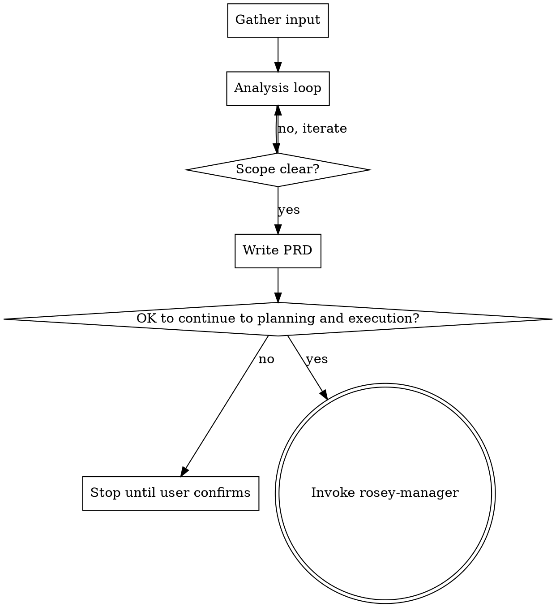

## Communication while using this skill

**Caveman lite** for all assistant prose while this skill runs: strip filler and hedging; keep articles and full sentences; stay professional and tight. Technical accuracy unchanged; quoted errors and code unchanged. Drop lite only for security warnings, irreversible confirmations, or when the user asks for normal or long-form wording.

# PRD from Features / User Stories

## Objective

Produce a single PRD markdown document in **docs/plans/<prd-slug>/** that reflects the agreed scope. Do **not** write the PRD until flaws, gaps, and doubts have been raised and resolved with the user.

## Checklist

You MUST complete these in order:

1. **Gather input** — read the design doc from rosey-brainstorm (if it exists); prd-slug is already set.
2. **Analysis loop** — report flaws, gaps, and doubts; iterate until scope is clear.
3. **Write the PRD** — save to `docs/plans/<prd-slug>/YYYY-MM-DD-<prd-slug>-prd.md` only after user confirmation.
4. **Transition to planning** — ask whether to continue to planning and execution; if yes, invoke rosey-manager.

## Process Flow



**The terminal state is invoking rosey-manager** (after the user agrees to continue). Do not write the PRD until the user confirms scope is clear (or explicitly asks to proceed with current assumptions documented as such). If the user is not ready to continue after the PRD is written, stop and wait; do not invoke rosey-manager until they confirm.

## Workflow

### 1. Gather input

- **prd-slug** is already decided (from the prior rosey-brainstorm run or provided by the user). Do not re-negotiate it.
- **Read the design doc first.** Use the `design-doc-path` from the rosey-brainstorm handoff (e.g. `docs/plans/<prd-slug>/YYYY-MM-DD-<prd-slug>-design.md`). If the path is not available, look in `docs/plans/<prd-slug>/` for a file matching `*-<prd-slug>-design.md`. Read it and use it as the primary input for features, scope, and architecture — do not ask the user to restate what the design doc already covers.
- If no design doc exists, get the initial feature set or user stories from the user.
- If the user only gives a high-level idea, ask for concrete features or user stories before continuing.

### 2. Analysis loop (mandatory before writing)

**Scope boundary with rosey-brainstorm:** rosey-brainstorm already validated the architectural approach and got user approval on the high-level design. Do not re-question those decisions. This analysis loop focuses on **requirements-level** detail: specific user stories, functional requirements, edge cases, permissions, and acceptance criteria that the design doc does not cover.

Before drafting the PRD:

- **Flaws**: Inconsistencies, contradictions, or conflicting requirements.
- **Gaps**: Missing actors, edge cases, error handling, permissions, or acceptance criteria.
- **Doubts**: Ambiguous wording, unclear scope, or assumptions that need confirming.

Report these to the user in a concise list (grouped by type if helpful). Ask clarifying questions. Repeat until:

- No critical flaws remain.
- Gaps are either filled or explicitly accepted as out-of-scope / later phase.
- Doubts are resolved or explicitly deferred.

Do **not** write the PRD until the user confirms scope is clear (or explicitly asks to proceed with current assumptions documented as such).

### 3. Write the PRD

- **Location**: `docs/plans/<prd-slug>/YYYY-MM-DD-<prd-slug>-prd.md` (e.g. `docs/plans/showcase-page/2026-02-19-showcase-page-prd.md`). Create the directory if it does not exist.
- **Content**: Use the structure below. Incorporate everything agreed in the analysis loop; call out any deferred items or assumptions in the PRD.

### 4. Transition to planning

After writing the PRD, ask the user a single question — for example:

**"The PRD is saved. Is it OK to continue to planning and execution of the plan (day-by-day plan, then implementation)?"**

- If **yes**: invoke the **rosey-manager** skill. Pass:
  - **prd-slug**
  - **prd-path**: the path to the PRD just written
  - **design-doc-path**: the path to the design doc from rosey-brainstorm
- If **no** or the user wants to pause: stop. Do not invoke rosey-manager until they confirm later.

Do NOT invoke any other skill. **rosey-manager** is the only next step; it produces the implementation plan, a Sentrux **topology** artifact (`<plan-basename>.topology.json` via [rosey-sentrux](../rosey-sentrux/SKILL.md)), and hands off to **rosey-developer** with **topology-path**.

## PRD document structure

Use this structure unless the project has a different standard:

```markdown
# PRD: [Title]

## Overview

[2–4 sentences: what this is and why.]

## Goals

- [Goal 1]
- [Goal 2]

## Scope

### In Scope

- [Item]

### Out of Scope

- [Item]

## User Stories

1. **As a [role]**, I want [action] so that [outcome].

## Functional Requirements

| ID   | Requirement   | Priority              |
| ---- | ------------- | --------------------- |
| FR-1 | [Requirement] | Must / Should / Could |

## Technical Approach

[High-level technical notes, stack, integrations.]

## Data Model Changes

[If any: tables, fields, migrations.]

## Open / Deferred

[Anything explicitly deferred or assumed for later.]
```

## Git Policy

**Allowed:** read-only git operations (`git status`, `git diff`, `git log`) for context and review.
**Forbidden:** `git commit`, `git push`, `git add`, or any command that modifies the repository. Only write files to disk. The user manages commits themselves.

## Summary checklist

- [ ] Design doc read (if available) or user provided features/user stories; prd-slug already set.
- [ ] Analysis loop done: flaws, gaps, doubts reported and iterated until clear.
- [ ] PRD written only after user confirmation (or explicit "proceed with assumptions").
- [ ] Output path: `docs/plans/<prd-slug>/YYYY-MM-DD-<prd-slug>-prd.md`.
- [ ] Deferred or assumed items listed in the PRD where relevant.
- [ ] User asked whether to continue to planning and execution; rosey-manager invoked only after confirmation, with prd-slug, prd-path, and design-doc-path.
